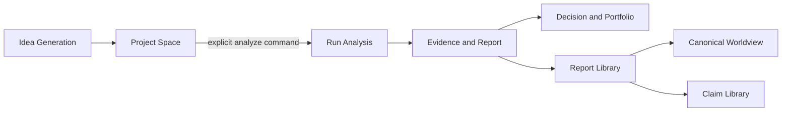

# Fin Agent

[](https://github.com/LuNa-shi/fin-agent/actions/workflows/clean-install.yml)
[](LICENSE)
[](https://nodejs.org/)

Fin Agent is a local-first investment research workspace. It turns ideas, market data, research evidence, model analysis, reports, worldview updates, and portfolio decisions into a durable and inspectable chain of work.



The project is experimental software for research workflows. It does not place trades, custody funds, or provide personal investment advice.

## What it does

### Durable idea generation

The Idea Generation workflow collects market context, builds diversification constraints, generates candidates, verifies ticker and provenance data, reviews quality, and persists accepted Ideas. Each run freezes its input snapshot and can be inspected or resumed.

### Project-based research

An Idea can become a Project through a deterministic command. Creating a Project does not call a model or start analysis. The user explicitly starts analysis with a selected research intensity and optional industry/company templates.

Run Analysis uses the canonical `run-analysis.v2` workflow:

1. Initialize a checkpoint.
2. Plan research.
3. Select candidates.
4. Run data, industry, and company research rounds.
5. Compose a report.
6. Run parallel evidence, requirement, logic, and scorecard reviews.
7. Synthesize a conclusion.
8. Publish the final Project artifacts.

Runs have durable identities, checkpoints, artifacts, events, pause/resume behavior, recovery, and safe public projections.

### Evidence and reports

Research outputs are stored as typed artifacts with schema, digest, producer, and lineage information. Reports enter the shared Report Library through `ReportAdmissionService`. Admission stages an immutable candidate and a private, digest-bound Report Overview before atomically publishing a ReportVersion.

The Report Library keeps public processing state intentionally small: a ReportVersion is either `Pending` or `Processed`. `Processed` is granted only by an exact committed receipt from a successful Canonical Worldview publication.

### Canonical Worldview and Claim Library

The Canonical Worldview is the system's durable body of investment reasoning. The Claim Library is a separate authority for falsifiable investment judgments, immutable Claim versions, action history, rejection history, evidence, and publication lineage.

One bounded Worldview run freezes its Reports, Overviews, current Worldview, current Claims, model configuration, retry policy, capabilities, and workspace digest before the first model call. The Core Worldview Agent produces a `KEEP` or `UPDATE` decision and ordered `ADD`, `UPDATE`, or `NOOP` Claim actions.

Worldview results, Claim changes, attempt audits, and exact Processed receipts are staged together and become visible only after one authoritative publication marker. Invalid individual Claim actions can be rejected independently; storage, integrity, locking, or publication failures fail the whole publication.

### Decision and portfolio tools

The Decision domain provides candidate ranking, portfolio promotion, position weights, tracking, snapshots, contracts, ledger entries, calibration, and decision traces. Decision consumers only accept research packages that pass their identity, artifact, lineage, digest, and publication checks.

### Inspectable Agent runtime

Production Agent calls use a single execution boundary:

```text
AgentExecutionRuntime
  -> IdempotentAgentBackend
  -> ConcurrentAgentBackend
  -> PiAgentBackend
```

Checked-in Agent definitions and ordered Tool Use policies are the protected baseline. Runtime Agent overlays and Skills are data-backed extensions that can narrow the allowed tool set but cannot silently expand it. `backend/src/tools/toolCatalog.js` is the single tool registration authority.

## Design principles

- **Explicit commands:** Project creation, analysis, recovery, admission, and publication have separate boundaries.
- **Durable work:** Long-running operations have stable identities, checkpoints, events, artifacts, and recovery paths.
- **Evidence before conclusions:** Structured evidence, citations, digests, and source provenance travel with research outputs.
- **Fail closed:** Invalid configuration, unavailable providers, unsafe scope, corrupted data, and publication failures do not become fake success.
- **Immutable history:** Reports, Worldview versions, Claim versions, artifacts, receipts, and audit records are retained as history.
- **Small public projections:** Public APIs hide credentials, raw provider payloads, private Overviews, local paths, and internal storage details.
- **Local-first operation:** Runtime data and credentials stay in local ignored directories unless an operator deliberately chooses another deployment model.

## Repository layout

```text
backend/src/
  agents/          Agent definitions, registry, overlays, and execution boundary
  core/            Models, contracts, workflow kernel, tools, validation, persistence
  domains/         Ideas, reports, worldview, claims, research, and decisions
  project-space/   Projects, runs, artifacts, events, workspaces, and projections
  workflows/       Idea Generation, Run Analysis, and Canonical Worldview workflows
  tools/           Tool catalog and provider-backed tool executors
  server.js        Express composition root and HTTP projections
frontend/src/      React product UI
documents/         Reviewed references and source-generated projections
artifacts/         Evaluation and reviewer-gate evidence
scripts/           Repository automation
```

The current runtime boundaries are documented in [`documents/current-agent-io.md`](documents/current-agent-io.md). Workflow, contract-consumer, and artifact-authority details are generated from source under [`documents/generated/`](documents/generated/). Historical architecture drafts are kept under [`documents/架构设计/`](documents/架构设计/) and should not be treated as current runtime authority.

## Requirements

- Node.js `>=22.19.0`
- npm
- Provider credentials only when running provider-backed work
- API credentials for optional data tools such as FMP, FRED, Perplexity, or Tavily

The Pi packages are pinned to:

- `@earendil-works/pi-ai@0.80.6`
- `@earendil-works/pi-agent-core@0.80.6`

## Quick start

Install dependencies and build the frontend:

```bash
cd backend
npm ci

cd ../frontend
npm ci
npm run build
```

Create a local environment file if you need provider-backed execution:

```bash
cp backend/.env.example backend/.env
```

Fill in only the credentials and provider settings you intend to use. `backend/.env` is ignored by Git and must never be committed.

Start the backend, which serves the built frontend:

```bash
cd backend
npm start
```

Open <http://localhost:8787>.

For frontend-only development:

```bash
cd frontend
npm run dev
```

Vite uses port `8878`. It does not proxy to the deployment service.

## Providers and execution modes

The supported provider identifiers are `openai-compatible` and `deepseek`. The repository default route is `openai-compatible/gpt-5.6-sol/high`; the `small`, `main`, and `reflection` tiers follow the default route unless explicitly configured.

Provider and model selection fails closed when the selected model is unavailable. The runtime does not silently switch providers, replay against another model, or fall back to demo mode. Deterministic demo behavior is available only through an explicit `DEMO_MODE` or documented demo route.

Ordinary tests, CI, startup, and deployment do not create provider-backed test tasks. Real model validation requires an explicit live opt-in, an isolated `FIN_DATA_DIR`, and an evidence root. See the repository policy in [`AGENTS.md`](AGENTS.md).

## Verification

Run focused checks while developing:

```bash
cd backend
npm test
npm run lint

cd ../frontend
npm test
npm run build
```

The complete clean-install gate is:

```bash
node scripts/clean-install-gate.mjs
```

It performs clean installs, backend tests, Agent asset Golden checks, lint, deterministic demo smoke, frontend tests, and a production build. Before submitting a change, also run:

```bash
git diff --check
git status --short
```

Passing automated checks does not establish the quality of a real investment report. Provider-backed quality evaluation is a separate, explicitly authorized activity.

## Data and security

Runtime data defaults to ignored `backend/data/`. Tests and local validation must use a temporary or task-specific `FIN_DATA_DIR` and must not write fixtures into runtime data.

Do not put credentials, provider endpoints, raw provider payloads, private Report Overviews, local filesystem paths, or user runtime data into source, tests, logs, issues, or documentation. For security reports, see [`SECURITY.md`](SECURITY.md).

The project is not an automated trading system. Portfolio and Decision surfaces are research aids and do not place orders.

## Documentation

- [`CONTRIBUTING.md`](CONTRIBUTING.md) — contribution and verification guide
- [`AGENTS.md`](AGENTS.md) — repository operation and data-safety rules
- [`documents/current-agent-io.md`](documents/current-agent-io.md) — current Agent, Report, Worldview, and Claim boundaries
- [`documents/generated/`](documents/generated/) — source-generated workflow and authority projections
- [`documents/standards/benchmark-and-reviewer-gates.md`](documents/standards/benchmark-and-reviewer-gates.md) — benchmark and reviewer-gate standard
- [`documents/架构设计/README.md`](documents/架构设计/README.md) — architecture reference index

## Contributing

Bug reports, focused improvements, documentation fixes, and reproducible test cases are welcome. Please read [`CONTRIBUTING.md`](CONTRIBUTING.md) before opening a pull request.

## License and attribution

Fin Agent is released under the [MIT License](LICENSE). The repository was independently published from an authorized code snapshot based on Kenzeq/Adaptors; existing copyright and third-party license notices remain in the source tree.
