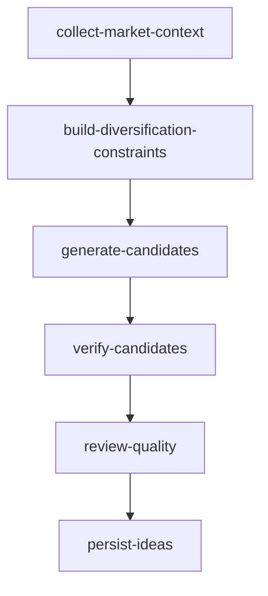

<!-- GENERATED FILE: run `cd backend && node scripts/generateWorkflowDocs.mjs` to refresh. -->

# Idea Generation WorkflowSpec

- Spec: `idea-generation.v2@2.0.0`
- Schema: `workflow-spec.v1`
- Deterministic hash: `sha256:087c7781a753b1c5f936993ed1d9d91771fe89fc6bac1411a886aa950630f1eb`
- Source: `backend/src/workflows/idea-generation/workflowSpec.js`
- Durable scope: `idea-universe` with a run-owned `idea-run` input snapshot.
- Publication rule: source material remains run input; every valid normalized/deduplicated generated Idea is persisted, while quality review supplies annotations/ranking only.

## Nodes

| Node | Kind | Handler binding | Dependencies | Condition binding | Agent contracts | Artifact policy | Formal output |
|---|---|---|---|---|---|---|---|
| collect-market-context | deterministic | collectMarketContext | — | always | — | artifact | captured source batch + current trace/provenance |
| build-diversification-constraints | deterministic | buildDiversificationConstraints | collect-market-context | always | — | artifact | immutable run artifact/ref |
| generate-candidates | agent | generateCandidates | build-diversification-constraints | always | idea-generator | artifact | candidate Idea artifacts |
| verify-candidates | deterministic | verifyCandidates | generate-candidates | always | — | artifact | verified candidates |
| review-quality | agent | reviewQuality | verify-candidates | always | idea-quality-reviewer | artifact | quality annotations/ranking |
| persist-ideas | deterministic | persistIdeas | review-quality | always | — | artifact | Idea folder refs + index projection |
