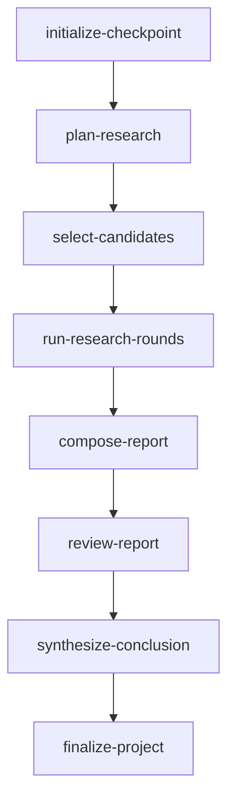

<!-- GENERATED FILE: run `cd backend && node scripts/generateWorkflowDocs.mjs` to refresh. -->

# Run Analysis WorkflowSpec

- Spec: `run-analysis.v2@2.0.0`
- Schema: `workflow-spec.v1`
- Deterministic hash: `sha256:12580210704a77827a353d260223e00f38b71fe9e92ff630eb570212a125c709`
- Source: `backend/src/workflows/run-analysis/workflowSpec.js`
- Execution status: production resolves all eight bounded handlers through the canonical dependency graph and declared parallel groups.

## Nodes

| Node | Kind | Handler binding | Dependencies | Condition binding | Condition description | Agent contracts | Parallel group | Artifact policy | Declared artifacts | Artifact selection |
|---|---|---|---|---|---|---|---|---|---|---|
| initialize-checkpoint | deterministic | initializeCheckpoint | — | always | always | — | — | pure-return | — | — |
| plan-research | agent | planResearch | initialize-checkpoint | checkpoint-plan-missing | checkpoint.plan == null | analysis-plan | — | contract-derived | — | — |
| select-candidates | composite | selectCandidates | plan-research | checkpoint-scan-missing | checkpoint.scan == null | scan-score | — | contract-derived | — | — |
| run-research-rounds | composite | runResearchRounds | select-candidates | checkpoint-research-rounds-pending | checkpoint.round < checkpoint.targetRounds \|\| active remediation owns data/industry/company | data-orchestrator, industry-analyst, company-analyst | — | artifact | data/data_plan_rN.json, data/source_documents_rN.json, data/evidence_bundle_rN.json, data/citation_ledger.json, data/domain_events_rN.json, data/organized_rN.json, data/data_report.md | {"roundField":"round","declaredRoundField":"dataRound"} |
| compose-report | agent | composeReport | run-research-rounds | checkpoint-report-missing | checkpoint.reportDone != true \|\| active remediation owns report | report-composer | — | contract-derived | — | — |
| review-report | composite | reviewReport | compose-report | checkpoint-report-review-missing | checkpoint.reportReview == null | evidence-reviewer, requirement-reviewer, logic-reviewer, data-scoreboard-evaluator, industry-scoreboard-evaluator, company-scoreboard-evaluator | — | artifact | analysis/reviews/report_quality_rN.json, analysis/scorecards/data_rN.json, analysis/scorecards/industry_rN.json, analysis/scorecards/company_rN.json | {"roundField":"reviewRound"} |
| synthesize-conclusion | agent | synthesizeConclusion | review-report | checkpoint-conclusion-missing | checkpoint.conclusion == null | conclusion-synthesizer | — | contract-derived | — | — |
| finalize-project | composite | finalizeProject | synthesize-conclusion | checkpoint-incomplete | checkpoint.done != true | — | — | artifact | report/report_*.md | {"resultPaths":[{"field":"finalReport.path","pattern":"report/report_*.md","required":true}]} |

## Parallel groups

| Group | Scope | Owner/members | Join |
|---|---|---|---|
| round-analysis | agent-contracts | run-research-rounds: industry-analyst, company-analyst | parallel-all |
| report-reviewers | agent-contracts | review-report: evidence-reviewer, requirement-reviewer, logic-reviewer | parallel-all |

## Remediation routes

> RV-01 executes these routes after read-only review adjudication, invalidating only the route union and stopping after two remediation cycles.

| Owner | Affected nodes / terminal |
|---|---|
| data | run-research-rounds → compose-report → review-report → synthesize-conclusion → finalize-project |
| industry | run-research-rounds → compose-report → review-report → synthesize-conclusion → finalize-project |
| company | run-research-rounds → compose-report → review-report → synthesize-conclusion → finalize-project |
| report | compose-report → review-report |
| system | human-review |

## Research rounds

The `run-research-rounds` composite executes the configured fixed Data-first rounds, then runs Industry and Company from the same committed Data closure.

