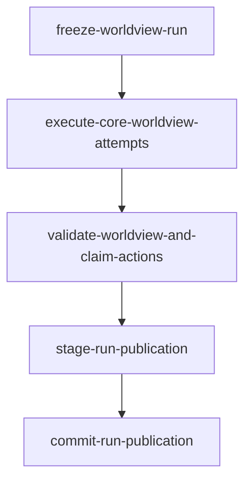

<!-- GENERATED FILE: run `cd backend && node scripts/generateWorkflowDocs.mjs` to refresh. -->

# Canonical Worldview Processing WorkflowSpec

- Spec: `canonical-worldview-processing.v1@1.0.0`
- Schema: `workflow-spec.v1`
- Deterministic hash: `sha256:d20af50771f178c17976ce6f75a58232a37aada2e9ad681196a44e71a82a5470`
- Source: `backend/src/workflows/worldview/canonicalWorkflowSpec.js`
- Scope: `worldview-universe` with `workspaceMode=none`.
- Run rule: one frozen contiguous Report Library range and one logical Core Worldview Agent execution with up to 3 complete Agent attempts.

## Nodes

| Node | Kind | Handler | Dependencies | Agent contracts |
|---|---|---|---|---|
| freeze-worldview-run | deterministic | freezeWorldviewRun | — | — |
| execute-core-worldview-attempts | agent | executeCoreWorldviewAttempts | freeze-worldview-run | core-worldview |
| validate-worldview-and-claim-actions | deterministic | validateWorldviewAndClaimActions | execute-core-worldview-attempts | — |
| stage-run-publication | deterministic | stageRunPublication | validate-worldview-and-claim-actions | — |
| commit-run-publication | deterministic | commitRunPublication | stage-run-publication | — |
