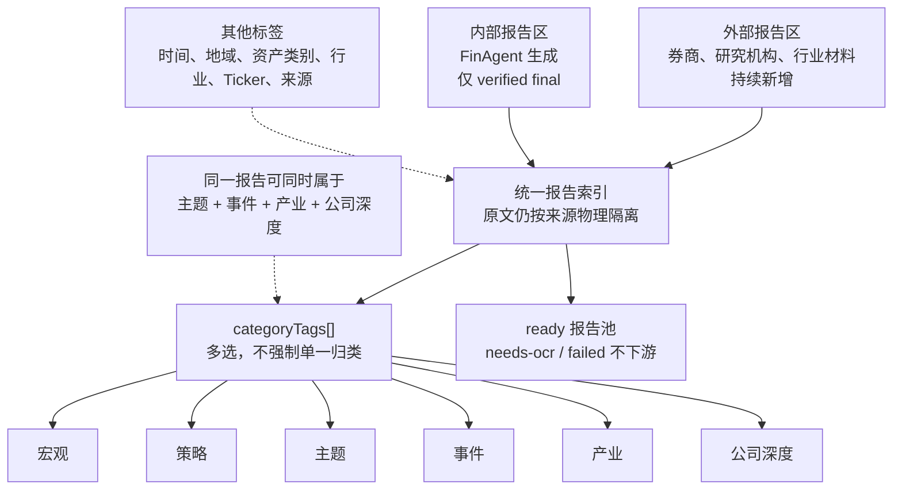
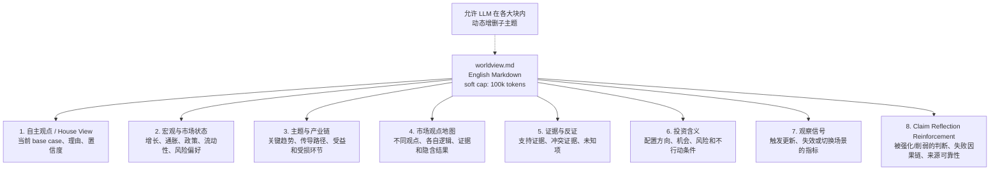
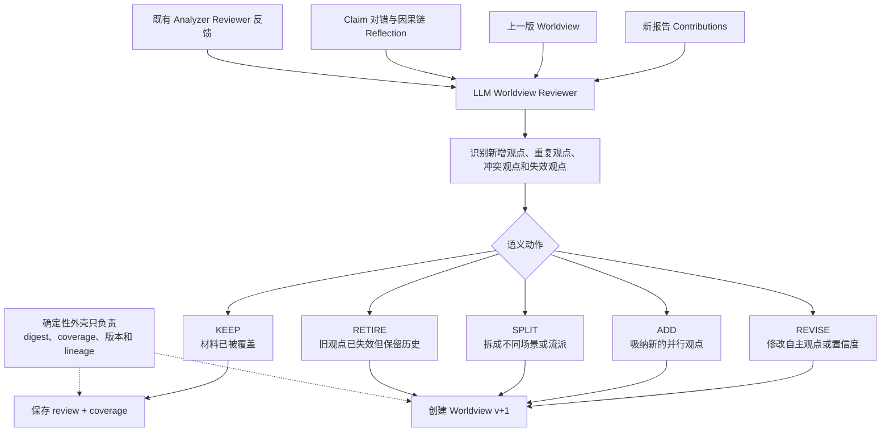
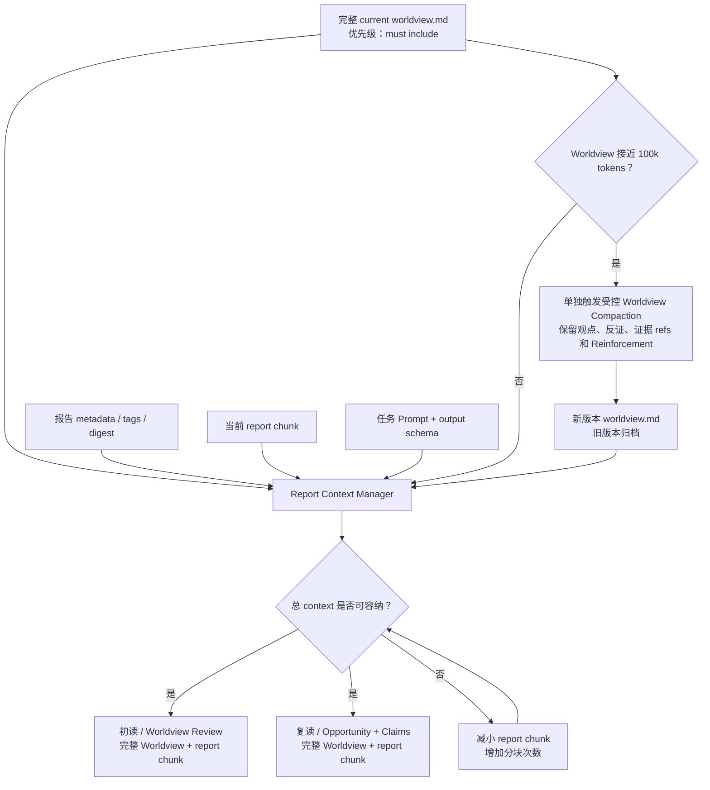
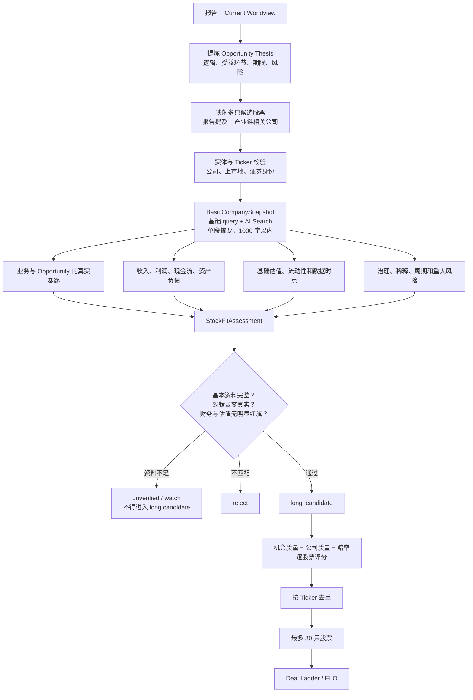
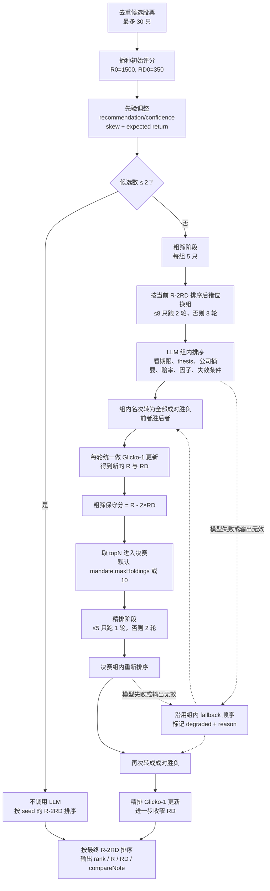
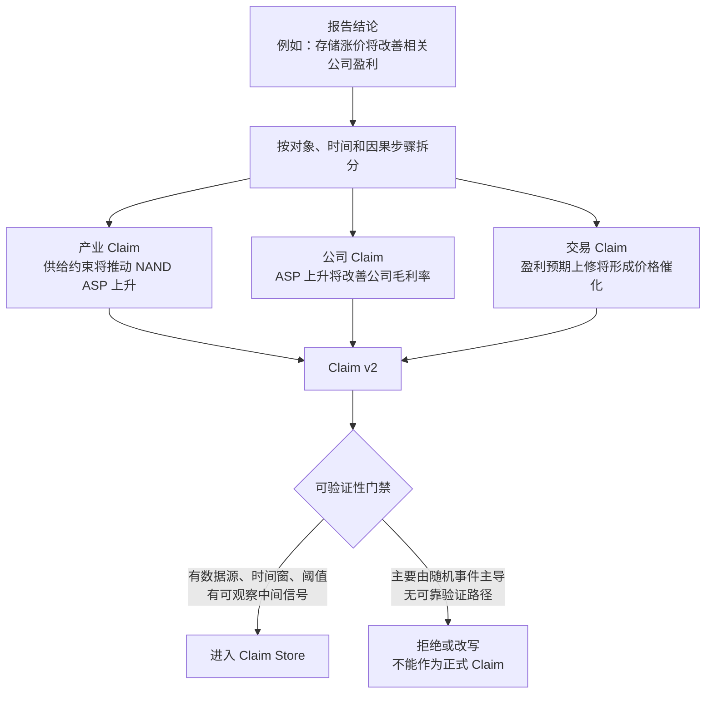
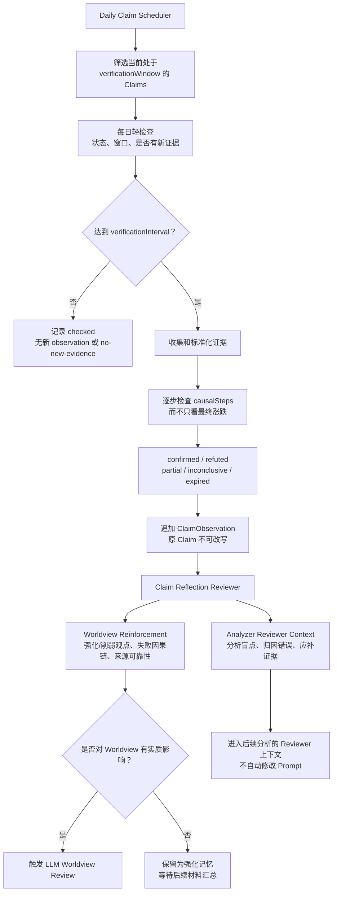

# 报告知识、Worldview 与投资信号系统 PRD

> - 版本：v4.0-draft
> - 日期：2026-08-09
> - 定位：图优先的产品评审稿

## 1. 产品主链

```text
报告库 → Worldview → Opportunity → 多股票基础核验 → 投资 Idea 初筛
                         ↓
                       Claims → 每日验证 → Reflection → Worldview 强化 / Analyzer Reviewer
```

30 篇外部报告只是初期测试样本。正式报告库持续扩展；“最多 30 个”仅指进入比较环节的股票候选数。

## 2. 报告索引：来源隔离，内容多标签



严格边界只有两类：

- 来源：`external / internal`；
- 提取状态：`ready / needs-ocr / failed`。

宏观、策略、主题、事件、产业、公司深度只是可扩展的检索标签。初期 30 篇测试样本清单仍以 `backend/scripts/support/external-report-sample.v1.json` 为准。

## 3. Worldview 应该怎么写

### 3.1 稳定外框，内部允许柔性变化

Worldview 的 canonical 产物是一个英文 Markdown 文档：`worldview.md`。它不是报告摘要，也不是固定打分表；它保留稳定的大块结构，但允许 LLM 根据材料增加、合并或拆分子主题。

当前版本尽量控制在 100k tokens 以内。100k 是软上限，不是鼓励写满的目标；超过前应通过受控重构去重和压缩，旧版本继续保留。



### 3.2 Worldview 的写作原则

- 先区分事实、外部观点、系统推断和最终自主观点。
- 吸纳不同观点，但不能简单平均；需要写清每种观点背后的逻辑和证据。
- 必须形成自己的 base view，并说明为什么暂时选择它、置信度多高、什么信号会改变它。
- 保留少数派观点和反证；它们进入“市场观点地图”和“证据与反证”，而不是被删除。
- “Claim Reflection Reinforcement”必须单独成块，记录历史判断哪些被强化、哪些被削弱，以及错在结果还是因果链。
- 顶层八块相对稳定，子标题、篇幅和观点数量由 LLM 根据材料柔性决定。

### 3.3 Worldview 怎样 review 和更新



Worldview 是否更新不使用僵硬的固定分数阈值。LLM 根据观点的新颖性、证据强度、冲突程度和投资影响做柔性判断；确定性代码只保证过程可追溯。

### 3.4 初读与复读的 Context Manager

Worldview review、报告初读和报告复读都应尽量装载完整的 current `worldview.md`，而不是只给模型一个 Worldview 摘要。



Context 规则：

- Worldview 是优先保留项；预算不够时先缩小报告 chunk，而不是截断 Worldview 尾部。
- 初读使用“完整 current Worldview + 报告分块”，判断报告是否带来新增或冲突。
- 复读使用“完整 resulting Worldview + 报告分块”，生成 Opportunity 和 Claims。
- 每次调用记录 `worldviewId`、Worldview token count、report chunk 范围和 context digest。
- 禁止静默只取 Worldview 摘要；若模型上下文仍无法容纳，应先完成显式 Compaction 或失败关闭。
- Compaction 是一次版本化的 LLM 编辑任务，不得丢失不同观点、关键证据、失效条件和 Claim Reflection。

## 4. Opportunity：一个逻辑可以对应多只股票

Opportunity 是投资逻辑，不是 ticker。一次报告二读可以形成一个或多个 Opportunity，每个 Opportunity 可以关联多只候选股票。



### 4.1 BasicCompanySnapshot 的形态

BasicCompanySnapshot 是一段公司摘要，不是表格，也不是一份新的公司深度报告。系统使用基础 company query、财务查询和 AI Search 快速拼接，正文控制在 1000 字以内。

这一段话应自然覆盖：公司与 Ticker 身份、主营业务和收入来源、与 Opportunity 的真实业务暴露、近期收入/利润/现金流和资产负债的基本状态、一个适用的基础估值视角、流动性及最重要的风险或红旗。`asOf`、查询来源和 evidence refs 作为段落外的轻量元数据保存。

没有足够资料、证券身份不清或无法证明公司确实受益时，只能进入 `watch/unverified`。这样可以避免“主题是对的，但映射出的公司完全没研究过”。

### 4.2 ELO / Deal Ladder 怎样工作

ELO 接收已经通过 BasicCompanySnapshot 和 StockFitAssessment 的去重股票，最多 30 只。它比较的是同一投资期限下“风险调整后的赚钱确定性 + 赔率”，不是让模型一次性拍脑袋选十只股票。

初始先验使用现有公式：

```text
R  = 1500
   + (recommendationScore / 100 - 0.5) × 500
   + capped skew / convexity bonus
   + clamp(expectedReturnPct / 40, -1, 1) × 120
RD = 350
```

缺少 recommendationScore 时退化使用 confidence；RD 在后续更新中保持在 30–350 之间。



ELO 输出含义：

- `R`：相对竞争力评分；
- `RD`：评分不确定度，证据不足时保持较高；
- `R - 2×RD`：最终保守排序分，避免一次偶然胜出把高不确定候选推到顶部；
- `compareNote`：最近有效的组内比较理由；
- `degraded`：本次是否使用过模型失败回退，必须对用户可见。

分组不是固定不变的。每轮依据当前保守分重新排序并错位换组，使强、中、弱候选在不同轮次遇到不同对手；组间可以并发，但一轮结束后才统一更新 R/RD，避免更新顺序影响结果。

## 5. Claim：不是猜方向，而是可验证的因果判断

### 5.1 从结论拆成可验证 Claim



### 5.2 Claim v2 必备字段

| 字段 | 含义 |
|---|---|
| `assertion` | 具体会发生什么，而不是只写涨跌 |
| `subject / linkedTickers` | 判断对象以及可能受影响的股票 |
| `horizon` | short / medium |
| `verificationWindow` | `startAt` 与 `endAt` |
| `verificationInterval` | 日、周或月；多久应形成一次深度 observation |
| `baseline` | 判断开始时的可比较基线 |
| `metric / operator / target` | 用什么指标、如何比较、达到什么条件 |
| `verificationSources` | 可实际取得的验证来源 |
| `causalNarrative` | 用一段话完整讲清原因、传导和结果 |
| `causalSteps[]` | 每一步的中间信号和预期时滞 |
| `downstreamEffects[]` | 可能出现的二阶、三阶连锁反应 |
| `invalidation` | 哪些事实会证明判断失效 |
| `exogenousRisks` | 可能打断因果链的外部随机因素 |
| `supportingEvidenceRefs` | 生成 Claim 时使用的证据 |

`causalNarrative` 示例：

> 云厂商资本开支上升会先推高服务器和存储采购，随后提高存储厂商产能利用率；在供给扩张滞后的情况下，库存下降和合约价上涨将改善毛利率，并在下一至两个财报期推动盈利预期上修。若新增产能提前释放或终端需求转弱，传导链在库存与价格环节失效。

可验证性门禁不排斥事件型 Claim，但事件必须有可观察的过程、前置信号或明确结果来源。完全依赖不可预测随机事件、且无法观察中间机制的判断不能进入正式 Claim Store。

## 6. Claim Side System：每天检查，按间隔深度验证

每日 Side System 与主报告分析解耦，独立运行。它每天扫描处于验证窗口内的 Claims；`verificationInterval` 决定何时需要做一次深度取证。



### Reflection 必须回答

- 最终结果是对、错、部分正确，还是暂时无法判断？
- 因果链哪一步得到支持，哪一步断裂？
- 方向正确是否只是碰巧，原始机制是否真的成立？
- 哪个前置信号最早暴露了错误？
- 是 Worldview 假设错、公司映射错、证据不足，还是时间窗口设错？
- 该结果应强化、削弱还是仅补充哪个 Worldview 观点？
- Analyzer Reviewer 下一次应要求补充什么证据或避免什么归因错误？

## 7. 确定性系统与 LLM 的职责

| 确定性系统负责 | LLM 负责 |
|---|---|
| Report/Claim/Worldview 身份、digest、版本和 lineage | 从报告中理解观点和因果逻辑 |
| 验证窗口、每日调度、verificationInterval | 将结论拆成可验证 Claims |
| 指标比较、数据时点、证据引用和状态机 | 权衡不同市场观点及其证据 |
| Opportunity 与股票实体校验、基础数据完整性 | 判断公司与 Opportunity 的业务相关性 |
| 不可变 Claim 与追加 Observation | 写 Worldview 自主观点和 Reflection |
| 失败关闭、人工 review 和审计 | 柔性 Keep/Revise/Add/Split/Retire |

LLM 不能伪造基础财务数据，也不能因为语言上“看起来合理”绕过可验证性门禁。

## 8. 当前实现与目标模型的差距

| 范围 | 当前 MVP | 目标模型 |
|---|---|---|
| 报告分类 | 单一 `layer` | 多选 `categoryTags[]` |
| Opportunity | 每报告一个、单 ticker | 每报告可有多个 Opportunity，每个映射多只股票 |
| 股票分析 | 轻量 ticker 输出 | 基础 query + AI Search 生成单段、1000 字以内的 `BasicCompanySnapshot`，再做 StockFitAssessment |
| Claim | 基础时间窗和单一因果字段 | Claim v2：验证间隔、因果步骤、连锁反应、随机性门禁 |
| Claim 追踪 | 人工 Observation 和 due 队列底座 | 每日 Side System、深度验证、Reflection Reviewer |
| Worldview | 固定六字段、Keep/Update | 英文 `worldview.md`、尽量小于 100k tokens、稳定八大块、观点地图和柔性语义动作 |
| Context Manager | Worldview object 作为普通输入 | 初读/复读优先全量装载 current `worldview.md`，通过缩小 report chunk 控制预算 |
| ELO | 已有 Glicko-1 Deal Ladder | 保留现有算法，并把公司摘要、分组轮次、R/RD、R-2RD 和 degraded 状态完整展示 |
| 反馈 | Claim 状态投影 | 独立 Reinforcement 区 + Analyzer Reviewer 上下文 |

## 9. 最小验收标准

- 一个 Opportunity 可以关联多只股票，每只股票都有独立的基础公司快照和适配判断。
- BasicCompanySnapshot 必须是一段不超过 1000 字的快速摘要，不得扩写成表格或公司深度报告。
- 没有基础资料、证券身份未确认或业务暴露不真实的股票不得进入 long candidate。
- Claim 必须有验证窗口、验证间隔、基线、目标、来源、因果段落、中间步骤、连锁反应和失效条件。
- 主要由不可预测随机事件主导且没有可观察中间信号的判断不能进入正式 Claim Store。
- Side System 每天扫描所有处于验证窗口的 Claims，并按 interval 形成深度 Observation。
- Reflection 同时判断最终结果与因果链，并分别回流 Worldview Reinforcement 和 Analyzer Reviewer。
- Worldview 保留不同观点及证据，但必须形成自己的 base view、置信度和改变条件。
- Worldview 的 canonical 文件是英文 `worldview.md`，尽量小于 100k tokens；超过前必须版本化压缩。
- 初读和复读 Context Manager 都应优先装载完整 current Worldview；不得静默截断或仅使用摘要。
- Worldview 内容由 LLM 柔性维护；确定性代码只控制 coverage、版本、lineage 和审计。
- ELO 必须展示 seed、分组/换组轮次、R、RD、`R-2×RD`、决赛和 degraded diagnostics。
- Claim、Observation 和旧 Worldview 版本不可被事后改写。
